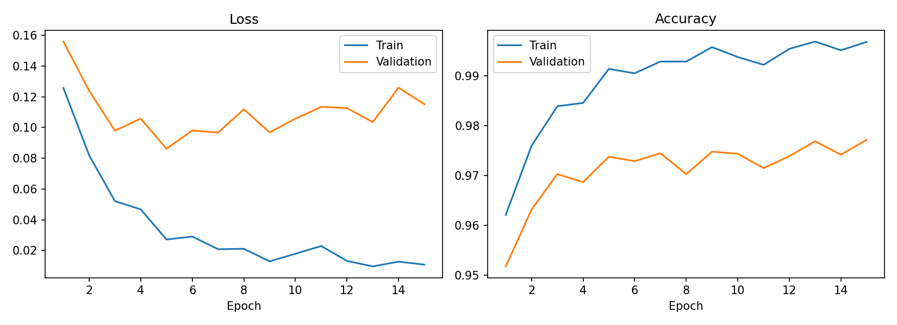
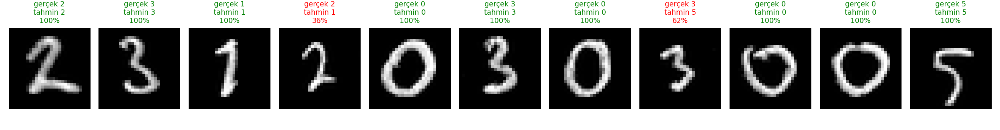

# MNIST ile MLP Tabanlı El Yazısı Rakam Tanıma

**Ad Soyad:** Zehra Ceren Kocaman\
**Öğrenci No:** 23120303005\
**Bölüm:** Fizik Mühendisliği

Bu projede, MNIST veri seti üzerinde PyTorch ile bir MLP modeli eğitildi.
Önce temel hiperparametre değerleri belirlendi, ardından bu parametreler tek
tek değiştirilerek etkileri gözlemlendi. Son olarak, temel parametrelerle
eğitilen model, kendi el yazımla yazdığım öğrenci numarası rakamları
üzerinde test edildi.

## 1. Veri Seti ve Ön İşleme
MNIST `torchvision` ile indirildi. Görüntüler `ToTensor()` ile [0,1] aralığına
çekildi ve MNIST ortalama/standart sapma değerleriyle (0.1307, 0.3081)
normalize edildi. Veri 50.000 eğitim, 10.000 doğrulama (validation) ve
10.000 test olarak ayrıldı (seed = 42). Test kümesi yalnızca eğitim bittikten
sonra bir kez kullanıldı.

## 2. Model ve Temel Ayarlar
Mimari: Flatten → 784 → 256 → 128 → 10 (ReLU), CrossEntropyLoss.

| Parametre | Temel değerler |
|---|---|
| Gizli katmanlar | [256, 128] |
| Optimizer | Adam |
| Learning rate | 0.001 |
| Batch size | 128 |
| Epoch | 15 |

## 3. Temel Model Sonuçları
| Metrik | Değer |
|---|---|
| Training loss / accuracy | 0.0107 / %99.68 |
| Validation loss / accuracy | 0.1152 / %97.72 |
| Test loss / accuracy | 0.1110 / %97.71 |
| Eğitim süresi | 77.6 sn |



## 4. Hiperparametre Deneyleri
Her deneyde temel modele göre yalnızca bir parametre değiştirildi.

| Deney | Temel değer | Denenen değer | Test doğruluğu | Temele göre | Val. doğruluğu | Süre |
|---|---|---|---|---|---|---|
| Temel model | - | - | %97.71 | - | %97.72 | 77.6 sn |
| Nöron sayısı | [256, 128] | [64, 32] | %97.36 | -0.35 | %96.96 | 72.2 sn |
| Learning rate | 0.001 | 0.01 | %96.85 | -0.86 | %96.25 | 74.3 sn |
| Optimizer | Adam | SGD (momentum 0.9) | %95.36 | -2.35 | %94.83 | 73.2 sn |
| Batch size | 128 | 512 | %97.95 | +0.24 | %97.59 | 67.7 sn |
| Epoch | 15 | 5 | %97.75 | +0.04 | %97.38 | 28.1 sn |

## 5. Kendi El Yazımla Öğrenci Numarası Testi
Numaramın 11 rakamı elle yazılıp taranarak MNIST formatına (siyah zemin, ortalanmış 28x28) getirildi ve temel modelle test edildi.
Sonuç: **9/11 doğru (%81,82)**.

| Konum | Gerçek | Tahmin | Güven |
|---|---|---|---|
| 1 | 2 | 2 | %100 |
| 2 | 3 | 3 | %100 |
| 3 | 1 | 1 | %100 |
| 4 | 2 | **1** | %36 |
| 5 | 0 | 0 | %100 |
| 6 | 3 | 3 | %100 |
| 7 | 0 | 0 | %100 |
| 8 | 3 | **5** | %62 |
| 9 | 0 | 0 | %100 |
| 10 | 0 | 0 | %100 |
| 11 | 5 | 5 | %100 |

Gerçek numara: `23120303005`, modelin okuduğu: `23110305005`.



## 6. Genel Değerlendirme

Temel model MNIST test kümesinde %97.71 doğruluğa ulaşırken, hiperparametre deneylerinde en büyük düşüşü SGD (−2.35 puan) ve yüksek learning rate (−0.86 puan) getirdi; kendi el yazımla yapılan testte ise 11 rakamın 9'u doğru tahmin edildi.

Ayrıntılı analiz ve grafik karşılaştırmaları için: [Rapor (PDF)](rapor/rapor.pdf)

## 7. Çalıştırma
```bash
pip install -r requirements.txt
python train.py
python evaluate_my_digits.py --images my_digits --model results/mlp_model.pt
```
